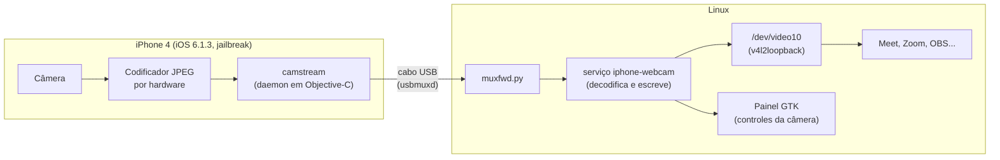

# iPhone 4 como webcam USB

Transformei um iPhone 4 parado na gaveta numa webcam USB para Linux. Para isso, rebaixei o aparelho
para o iOS 6.1.3 com jailbreak, escrevi um daemon nativo que usa o codificador JPEG por hardware do
iPhone e um serviço no Linux que entrega o vídeo como uma câmera comum. Meet, Zoom, OBS e Discord
enxergam uma câmera chamada "iPhone 4".

**Resultado:** 640×480 a 24–29 fps, com cerca de 70 ms de atraso, pelo cabo USB.

## Como funciona

- **No iPhone:** o `camstream` é um daemon sem interface que captura a câmera e serve os quadros em
  MJPEG só para o próprio aparelho. A câmera só liga quando algum app abre a webcam e desliga
  alguns segundos depois que o último app solta.
- **No Linux:** o usbmuxd leva a conexão pelo cabo, o serviço decodifica cada quadro e escreve direto
  num dispositivo de vídeo virtual. Uma regra do udev liga o serviço quando o iPhone é plugado.
- **Painel:** um app em GTK 4 mostra a prévia e controla lanterna, zoom, foco, exposição (com ISO e
  obturador manuais), balanço de branco, lente e resolução.

## Etapas

### 1. Jailbreak e downgrade

O aparelho estava no iOS 7.1.2. Com o Legacy iOS Kit (powdersn0w), rebaixei para o iOS 6.1.3, que
tem jailbreak permanente e é mais leve no hardware do iPhone 4. Depois instalei o OpenSSH para
desenvolver e instalar os programas pelo terminal.

### 2. Fazer o Linux enxergar o iPhone pelo cabo

O iPhone não aparecia no usbmuxd, e o log só dizia `lockdown error -5`. Decompilei a
libimobiledevice com o Ghidra e vi que o problema não era a versão do TLS nem a cifra. Reproduzindo
o handshake em Python, apareceu o erro real: o TLS do iOS 6 não implementa a renegociação segura
(RFC 5746), e o OpenSSL 3 recusa esse tipo de servidor por padrão. A correção libera isso **só para
o usbmuxd**, sem enfraquecer o resto do sistema.

### 3. Câmera sem app aberto

As strings do sistema sugeriam que o iOS 6 corta a câmera de apps em segundo plano. Testando, um
processo de linha de comando rodando como root captura normalmente. Por isso o `camstream` é um
daemon (LaunchDaemon) que sobe no boot e reinicia sozinho se cair.

### 4. JPEG por hardware (engenharia reversa)

Comprimindo cada quadro na CPU, o iPhone 4 só chegava a 7 fps. O codificador por hardware existe,
mas não tem API pública. Procurando no cache de bibliotecas do sistema (`dyld_shared_cache`), achei
a função privada `FigAspenCreateJPEGFromCVPixelBuffer` no framework Celestial. Para descobrir a
assinatura, escrevi ferramentas que recortam o código de dentro do cache e o embrulham num ELF que o
Ghidra consegue ler. Com a assinatura em mãos, o `camstream` carrega a função em tempo de execução.

| Resolução | Compressão na CPU | Compressão por hardware |
| --- | --- | --- |
| 640×480 | 7,4 fps | **24 fps** |
| 1280×720 | inviável | 12 fps |

### 5. Exposição manual escondida

O iOS 6 não tem exposição manual pública, mas o sistema guarda métodos privados para isso. Lendo os
tipos em tempo de execução, descobri que, depois de ativar um modo escondido, aparece o mesmo modo de
exposição manual que a Apple só publicaria no iOS 8. Com isso o painel controla ISO e obturador.

### 6. Atraso baixo

- **Sem ffmpeg no caminho:** ele segurava de 3 a vários quadros antes de soltar o primeiro. O serviço
  passou a decodificar com o Pillow direto no formato da câmera virtual (~19 ms por quadro).
- **Controle de fluxo:** o cabo rende ~3 MB/s, quase o que 640×480 a 30 fps gera. Qualquer engasgo
  acumulava quadros e o atraso subia até 1 s. Agora o Linux confirma cada quadro e o iPhone só manda
  o próximo (sempre o mais novo). Depois de um engasgo de 3 s, o atraso médio caiu de 804 ms para 71 ms.

## Tecnologias

| Parte | Tecnologias |
| --- | --- |
| iPhone | Objective-C, AVFoundation, CoreVideo, IOSurface, Theos, LaunchDaemon |
| Linux | Python, v4l2loopback, usbmuxd, libimobiledevice, systemd, udev, GTK 4 |
| Engenharia reversa | Ghidra, análise do `dyld_shared_cache`, runtime do Objective-C, OpenSSL |

## Autor

Guilherme De Avila e Carvalho, estudante de Engenharia de Computação na UnB.
[LinkedIn](https://www.linkedin.com/in/guilherme-de-avila-e-carvalho-12a613214)
